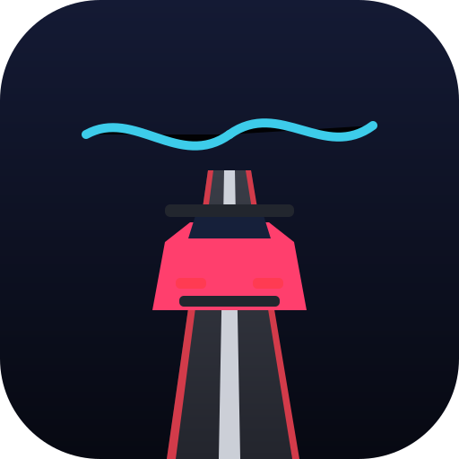

# Driftline

An endless 3D driving world. Real vehicle physics, drift scoring and
serverless peer-to-peer multiplayer - no backend, no build step.



## What it is

- **One infinite world.** The road is generated on the fly from a seed: curves,
  hills, changing width and dedicated drift areas. Chunks are streamed in ahead
  of the player and released behind, so memory and draw calls stay flat no
  matter how far you drive.
- **Real driving physics.** A rigid body chassis with four independent
  raycast wheels, springs, dampers, weight transfer, a tyre model with a
  friction circle and counter steering. One wheel rolling over a rock lifts
  that corner only - the car never launches into the air and never sinks.
- **Three cars** with different mass, power, grip and suspension.
- **Peer-to-peer multiplayer.** WebRTC data channels, manual invite codes or a
  same-device BroadcastChannel. Other players are ghosts: they never block you.
  Everyone shares the same world seed, so the road is identical everywhere.
- **Mobile and desktop.** Touch controls with an analog steering pad, tilt
  steering, full keyboard and gamepad support.

## Running it

```bash
npm install
npm start        # http://localhost:8080
```

The dev server prints a LAN address, so you can open it on a phone. Any static
host works - there is no server side component at all.

## Tests

```bash
npm test         # node:test suite, no browser needed
npm run typecheck
npm run verify   # typecheck + tests
```

The suite covers the math, the RNG, the road generator, the vehicle physics
(suspension, weight transfer, one wheel on a step, handbrake recovery), the
race-free world streaming, the wire protocol, the serverless signalling, the
multiplayer session and a head-less bot that drives the endless road.

## Controls

| Key            | Action            |
| -------------- | ----------------- |
| Arrows / WASD  | Drive             |
| Space          | Handbrake (drift) |
| Shift          | Boost             |
| R              | Respawn           |
| Esc / P        | Pause             |
| M              | Mute              |

On a phone: the steering pad on the left, gas/brake/drift/boost on the right.

## Layout

```
index.html              entry point
styles/                 base + game CSS
src/core/               math, rng, loop, input, storage
src/game/               road, vehicle, chunks, scene, renderer, camera,
                        effects, audio, hud, menus, world, assets
src/net/                protocol, signalling, peer, session
tests/                  node:test suite
tools/serve.mjs         zero dependency static server
tools/run-tests.mjs     portable test runner
assets/models/          CC0 asset packs (Kenney)
vendor/three/           vendored Three.js (core + addons)
```

## Assets

The cars and scenery are CC0 models by Kenney, vendored in `assets/models/` so
the game works offline. Procedural fallbacks are used when an asset is missing.

## License

MIT. Asset packs are CC0 by Kenney.
